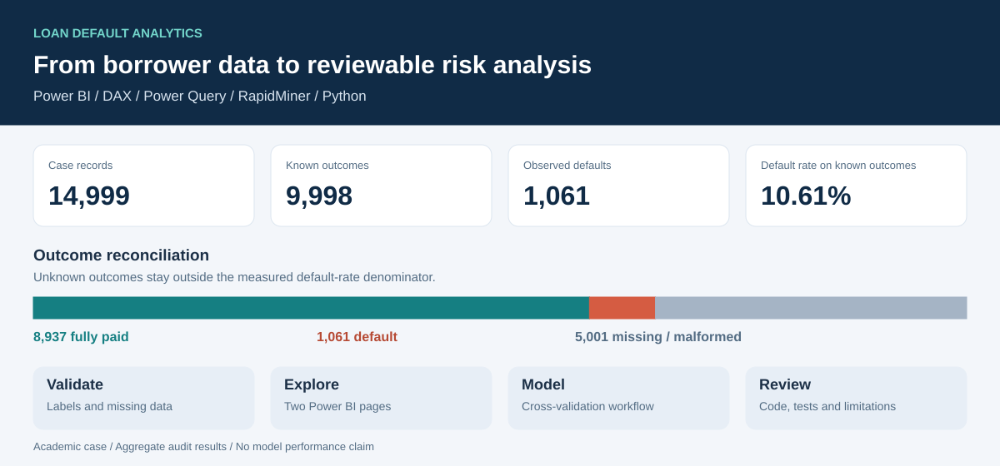
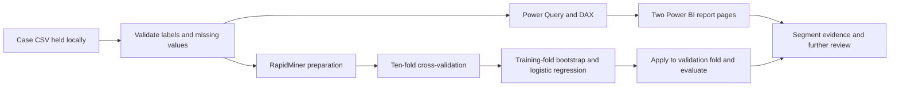
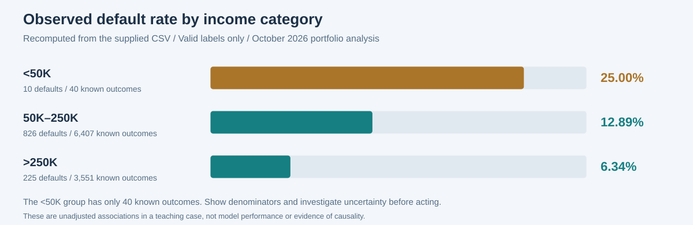

# Loan Default Analytics

**Power BI · DAX · Power Query · RapidMiner · Classification · Python data validation**

A credit risk analytics portfolio built from a University of Queensland BISM7233 case. It connects borrower profiling in Power BI with a RapidMiner classification workflow, and makes the underlying calculations, model settings and data-quality decisions reviewable in GitHub.

The supplied case contains **14,999 customer records and 24 fields**. Among the **9,998 records with valid repayment outcomes**, **1,061 defaulted: 10.61%**. The Power BI file's stored outcomes independently reconcile to these counts. The remaining 5,001 records have missing or malformed labels and are excluded from this measured rate.



**[Technical walkthrough](docs/powerbi.md) · [Predictive workflow](docs/modelling.md) · [Data quality](docs/data-quality.md) · [Interview guide](docs/interview-guide.md) · [繁體中文](README.zh-TW.md)**

## What I built

| Capability | Implementation | Inspect the evidence |
| --- | --- | --- |
| Define a business question and usable metrics | Separate borrower volume, observed defaults and default rate; compare demographic and financial segments | [Business analysis](docs/business-analysis.md) |
| Build a Power BI report | Two report pages, ten analytical charts/matrices, six KPI cards and four slicers | [Report metadata](powerbi/report-metadata.json), [design maps](docs/powerbi.md) |
| Write reusable DAX | 12 measures using `CALCULATE`, `DIVIDE`, `ALLSELECTED`, `KEEPFILTERS` and `REMOVEFILTERS` | [Actual extracted measures](powerbi/measures.dax) |
| Engineer interpretable features | 13 calculated columns covering outcome labels, age/education groups, financial bands and sort keys | [Actual calculated columns](powerbi/calculated-columns.json) |
| Prepare data with Power Query | CSV ingestion, explicit data types, income sort key and row sorting | [Original M logic](powerbi/Loan.original.pq), [portable adaptation](powerbi/Loan.portable.pq) |
| Design supervised learning | Target/ID roles, missing-value handling, Z-transformation, dummy coding, ten-fold cross-validation and training-fold bootstrapping | [Original RapidMiner process](rapidminer/loan-default-original.rmp) |
| Evaluate model tradeoffs | Recall as the selected main criterion; accuracy, precision and ROC AUC enabled; random forest retained as an inactive alternative | [Model settings and limitations](docs/modelling.md) |
| Make results reproducible | Standard-library Python audit, synthetic fixture, behavioural tests and GitHub Actions | [Run locally](#run-the-public-demo), [validation](docs/validation.md) |

The Power BI and RapidMiner files are the original supplied work. The Python audit, extracted code, aggregate reconciliation, diagrams and documentation are October 2026 portfolio additions prepared with AI assistance. [Provenance](evidence/README.md) separates these contributions.

## Business question

Which borrower characteristics are associated with observed loan default, and how could a classification model support further risk review?

The Power BI report explores this through **Customer Profile** and **Financial and Credit Risk** pages. The predictive workflow addresses class imbalance and includes logistic regression and random forest configurations. Model performance outputs were not supplied, so this portfolio makes **no accuracy, AUC, best-model or financial-return claim**.



## Findings that can be checked

| Finding | Evidence | Analytical implication |
| --- | --- | --- |
| 5,000 missing labels and one malformed label | [Source audit](analysis/source-audit.json) | Using all rows as the rate denominator would understate observed default risk |
| 10.61% observed default rate | 1,061 defaults / 9,998 valid labels; [PBIX reconciliation](analysis/pbix-stored-summary.json) | The majority-class accuracy baseline is 89.39%; accuracy alone would be misleading |
| Income groups differ in the labelled cohort | 12.89% for `50K–250K` (n=6,407), 6.34% for `>250K` (n=3,551) | An association to investigate; the data do not establish causality |
| Small groups can look extreme | `<50K` has 10 defaults among 40 known outcomes | The original sample-size measure suppresses rates below n=100 in the loan-purpose chart |
| Missing data have multiple representations | Blanks and literal `?` occur in employment, occupation and origin fields | Treating `?` as an observed category changes the missing-data policy |

The income aggregates were recomputed from the local CSV, rather than read from a dashboard screenshot. They describe this teaching case and do not establish lending policy or prediction performance. See [analysis and interpretation](docs/business-analysis.md).



This figure is an October 2026 portfolio addition based on the committed aggregate results.

## Inspect the report without Power BI

The [two report design maps and technical review](docs/powerbi.md) preserve the analytical visual positions and field bindings recovered from the PBIX. They are explicitly labelled metadata reconstructions, not rendered dashboard screenshots; decorative shapes and images are omitted.

The review also identifies concrete improvements: the original income sort rule misses the en dash in the supplied data, the loan-amount combo chart binds default rate to both axes, and learned preprocessing sits before cross-validation. These are documented alongside a [proposed evaluation design](docs/modelling.md#next-evaluation-design), without changing the historical workflows or inventing results.

## Run the public demo

Python 3.10+; no external packages, Power BI licence or course data required.

```bash
git clone https://github.com/1121eason/UQxLoanRisk-Analytics.git
cd UQxLoanRisk-Analytics
python scripts/audit_data.py data/demo/loan_demo.csv --output output/demo-audit.json
python -m unittest discover -s tests -v
python scripts/verify_repository.py
```

The **12-row fixture is entirely artificial** and deliberately includes unlabelled and malformed outcomes, blank ages and `?` values. Its results are unrelated to model performance on the original case. The [expected audit](data/expected/demo-audit.json) is committed for comparison.

For someone who already has permission to access the course data:

```bash
python scripts/audit_data.py /path/to/loan-data.csv --output output/source-audit.json
python scripts/summarise_segments.py /path/to/loan-data.csv --output output/income-segments.json
```

Opening and executing the original visual tools requires the local files and compatible software. See [setup](docs/setup.md). The optional PBIX extraction path is documented separately and is not needed for the demo.

## Repository map

| Path | Contents |
| --- | --- |
| `powerbi/` | Extracted DAX, calculated columns, M code and visual metadata, without table records |
| `rapidminer/` | Original process plus an archived alternative; no trained model or saved metrics |
| `analysis/` | Aggregate CSV audit, income comparison and stored PBIX outcome reconciliation |
| `assets/` | Portfolio overview and explicitly labelled report design maps |
| `docs/` | Business interpretation, data dictionary, methodology, review, setup and interview guide |
| `scripts/`, `tests/`, `data/` | Runnable audit, synthetic example and behavioural verification |
| `evidence/` | Input checksums and contribution register |
| `private/` | Ignored local originals; absent from the public repository |

**Public-data boundary:** the original CSV, PBIX files, course brief, dictionary and rubric stay local. PBIX contains embedded records and is excluded even though it is a report file. Only aggregate source results, logic, metadata and artificial example records are published.

**Author:** Yi Cheng Lee (Eason) · University of Queensland. Academic project; no production deployment or live lending use is claimed. See [usage and attribution](NOTICE.md).
