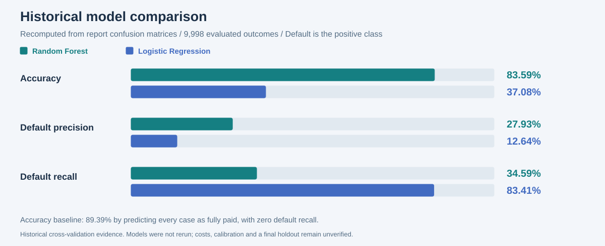
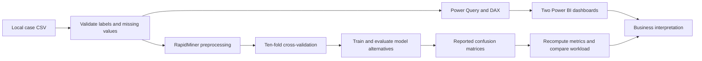

# Loan Default Analytics

**Power BI · DAX · Power Query · RapidMiner · Classification · Python data validation**

A loan default case study combining two Power BI dashboards with a comparison of Random Forest and Logistic Regression. This portfolio shows the original report screenshots, extracted analytical code and reproducible checks behind the results.

The analysis covers **14,999 customers and 24 fields**, with **9,998 valid repayment outcomes** and **1,061 defaults (10.61%)**. The report's two confusion matrices both reconcile to this labelled population. The original CSV, PBIX and full reports remain local; the public repository contains selected aggregate screenshots and code.

**[Original dashboards](docs/powerbi.md) · [Model comparison](docs/model-results.md) · [Technical workflow](docs/modelling.md) · [Interview guide](docs/interview-guide.md) · [繁體中文](README.zh-TW.md)**

## Original Power BI work


The original Customer Profile dashboard combines customer counts and default rates with age, education, occupation, marital status, employment and gender comparisons. A second [Financial and Credit Risk dashboard](docs/powerbi.md#original-dashboard-screenshots) explores income, loan amount, loan purpose and bankruptcy history.

Both images were extracted from the actual assignment report, not recreated for the portfolio. Report page references and image checksums are recorded in the [figure manifest](evidence/figures/manifest.json).

## Historical model results

| Model | Accuracy | Default precision | Default recall | F1 from pooled counts |
| --- | ---: | ---: | ---: | ---: |
| Random Forest | 83.59% | 27.93% | 34.59% | 30.91% |
| Logistic Regression | 37.08% | 12.64% | 83.41% | 21.96% |

These are historical cross-validation results from the report. Accuracy, precision and recall are the reported micro/pooled values, independently checked against the screenshots. F1 was recomputed from the pooled confusion counts; it is not a mean of fold-level F1 scores. No model was retrained for this portfolio update.



The report preferred Random Forest for a human-review workflow because it produced fewer false positives. Its matrix flags **1,314 cases**, including **367 actual defaults and 947 false positives**. Logistic Regression flags **7,000 cases**, capturing **885 actual defaults** but generating **6,115 false positives**. This makes the review-workload versus missed-default tradeoff explicit.

**Accuracy needs context:** predicting every known outcome as fully paid gives 89.39% accuracy and zero default recall. Both models score below that accuracy baseline. Random Forest also misses 694 of the 1,061 defaults. The report's preference is therefore a case-study choice to investigate further, rather than proof of deployment readiness. [Full matrices, fold summaries and interpretation](docs/model-results.md).

## What this project demonstrates

| Capability | Concrete implementation | Evidence |
| --- | --- | --- |
| Translate a business question into metrics | Separate total customers, known outcomes, observed defaults and segment rates | [Business interpretation](docs/business-analysis.md) |
| Design analytical dashboards | Two report pages, ten charts/matrices, six KPI cards and four slicers | [Original dashboard screenshots and review](docs/powerbi.md) |
| Write reusable DAX | 12 measures using `CALCULATE`, `DIVIDE`, `ALLSELECTED`, `KEEPFILTERS` and `REMOVEFILTERS` | [Extracted measures](powerbi/measures.dax) |
| Build interpretable features | 13 calculated columns for labels, age/education groups, financial bands and sort keys | [Calculated columns](powerbi/calculated-columns.json) |
| Transform source data | CSV ingestion, explicit types and category sorting | [Original M](powerbi/Loan.original.pq), [portable adaptation](powerbi/Loan.portable.pq) |
| Prepare mixed data for classification | ID/label roles, missing values, scaling, dummy coding and training-fold bootstrapping | [Original process](rapidminer/loan-default-original.rmp), [execution screenshots](docs/modelling.md) |
| Compare models using business consequences | Precision/recall, false positives, missed defaults and case-review volume | [Model evidence](docs/model-results.md) |
| Validate and communicate limitations | Check denominator choices, source encoding, chart bindings and preprocessing placement | [Data quality](docs/data-quality.md), [validation status](docs/validation.md) |
| Make analysis reproducible | Standard-library Python audits, synthetic fixtures, behavioural tests and GitHub Actions | [Scripts](scripts), [tests](tests), [setup](docs/setup.md) |

## Analytical architecture



## Data quality and interpretation

- **5,000 blank targets and one malformed target** remain unknown. They do not enter measured default-rate or supervised-evaluation denominators.
- **Blank and literal `?` values** appear in employment, occupation and origin fields. Import and replacement rules need to handle these explicitly.
- **Income comparisons need sample sizes:** the `<50K` group has only 40 valid outcomes. The original sample-size measure suppresses rates below n=100 in the loan-purpose chart.
- **Offline review found concrete improvements:** an income dash/sort mismatch, a loan-amount combo chart bound to default rate on both axes, and learned preprocessing placed before cross-validation.

[Source audit](analysis/source-audit.json), [income aggregates](analysis/income-segments.json) and [PBIX stored-outcome reconciliation](analysis/pbix-stored-summary.json) make these findings checkable. The report screenshots establish historical outputs; native interaction testing, full prediction-level reproduction and independent holdout validation remain separate tasks.

## Run the public verification

Python 3.10+; no external packages or course data required.

```bash
git clone https://github.com/1121eason/UQxLoanRisk-Analytics.git
cd UQxLoanRisk-Analytics
python scripts/audit_data.py data/demo/loan_demo.csv --output output/demo-audit.json
python scripts/audit_model_results.py --output output/model-comparison.json
python -m unittest discover -s tests -v
python scripts/verify_repository.py
```

The 12-row CSV fixture is entirely artificial. The model audit instead recomputes metrics from the original report's aggregate confusion counts, without accessing borrower records or fitting classifiers. Optional native-tool and report-extraction steps are in [setup](docs/setup.md).

## Repository map

| Path | Contents |
| --- | --- |
| `evidence/` | Nine original report screenshots, figure checksums, metric transcription and provenance |
| `powerbi/` | Extracted DAX, calculated columns, parameterised M and visual metadata |
| `rapidminer/` | Original saved process and an archived alternative |
| `analysis/` | Source audit, stored PBIX reconciliation, income aggregates and model-metric audit |
| `docs/` | Methodology, model comparison, business interpretation, setup and interview guide |
| `assets/` | Clearly labelled portfolio charts and metadata design maps |
| `scripts/`, `tests/`, `data/` | Reproducible checks, artificial fixture and expected output |
| `private/` | Ignored local CSV, PBIX and full documents; absent from GitHub |

**Author:** Yi Cheng Lee (Eason) · University of Queensland. The original academic report and screenshots are distinguished from October 2026 portfolio additions prepared with AI assistance. See [provenance](evidence/README.md) and [usage notes](NOTICE.md).
