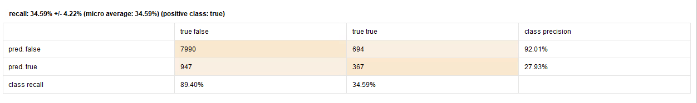
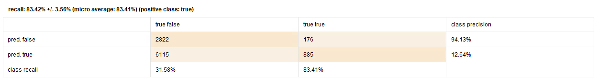

# Model comparison from the actual report

The student-named, 15-page report supplies two Power BI screenshots, RapidMiner process/results screenshots and two confusion matrices. The 16-page `1.pdf` is an alternate report supplied alongside it. The student-named version is the main source for the public figures; both complete PDFs remain local.

The metrics below are **historical report evidence**, checked against aggregate counts. They are not a new training run or an independent reproduction of the full modelling process.

## Original confusion matrices

Both screenshots are from page 11, section 3.2.1. Rows are predicted classes and columns are actual classes. `true` is the default class, consistent with the report's target definition and the 1,061 actual-positive total.

**Random Forest**

**Logistic Regression**

| Count | Random Forest | Logistic Regression |
| --- | ---: | ---: |
| Correctly identified fully paid (TN) | 7,990 | 2,822 |
| Fully paid flagged as default (FP) | 947 | 6,115 |
| Missed defaults (FN) | 694 | 176 |
| Correctly identified defaults (TP) | 367 | 885 |
| Evaluated outcomes | 9,998 | 9,998 |
| Actual defaults | 1,061 | 1,061 |

Both matrices reconcile to the independently audited CSV and stored PBIX outcome totals. That establishes aggregate consistency; it does not identify the exact executable file, preprocessing parameters or predictions used for each historical run.

## Recomputed metrics

| Metric | Formula | Random Forest | Logistic Regression |
| --- | --- | ---: | ---: |
| Accuracy | (TP + TN) / N | 83.59% | 37.08% |
| Default precision | TP / (TP + FP) | 27.93% | 12.64% |
| Default recall | TP / (TP + FN) | 34.59% | 83.41% |
| Pooled F1 | 2TP / (2TP + FP + FN) | 30.91% | 21.96% |
| Flagged cases | TP + FP | 1,314 | 7,000 |
| Flag rate | Flagged cases / N | 13.14% | 70.01% |

[`reported-model-results.json`](../evidence/reported-model-results.json) records the visually checked transcription. [`audit_model_results.py`](../scripts/audit_model_results.py) recomputes the metrics, checks the reported rounded values and reconciles the population. Its deterministic output is [`model-comparison.json`](../analysis/model-comparison.json).

The report gives approximate F1 values of 30.9% and 21.9%. This portfolio uses the exact pooled counts above. Neither value is presented as a native fold-average F1 metric.

## Fold summaries and micro values

The report separately lists fold-level averages with `±` spreads:

| Metric | Random Forest reported mean ± spread | Logistic Regression reported mean ± spread |
| --- | ---: | ---: |
| Accuracy | 83.59% ± 0.82 points | 37.08% ± 4.25 points |
| Precision | 27.94% ± 2.60 points | 12.67% ± 0.60 points |
| Recall | 34.59% ± 4.22 points | 83.42% ± 3.56 points |

The headline comparison uses the report's micro/pooled values, which match the matrices. A mean of fold ratios can differ from a ratio computed after pooling counts. The `±` values are preserved as reported and are not reinterpreted as confidence intervals; individual fold outputs were not supplied. No ROC AUC or PR AUC score is visible in the report, although AUC is enabled in the saved process.

## Interpretation for a business reviewer

The report recommends Random Forest because its lower false-positive volume would create fewer unnecessary reviews than Logistic Regression in this case. At the displayed operating points, that choice trades away sensitivity: Random Forest misses **694 defaults**, whereas Logistic Regression misses **176**.

The all-fully-paid baseline has **89.39% accuracy and zero default recall**. Both models have lower accuracy. Their possible value must therefore be assessed through default detection, errors, review capacity and explicit costs. Higher accuracy relative to the other candidate alone does not establish business value. No loss estimates or operational savings can be computed from the supplied artifacts.

A defensible portfolio conclusion is: **Random Forest is the report's preferred candidate for further evaluation under constrained review capacity; threshold selection, cost analysis, calibration and independent validation remain open.** This preserves the assignment's selection while stating the evidence it still needs.

## Interpretation evidence and limits

The report includes a [tree view](../evidence/figures/forest-tree-example.png) and a [partial logistic coefficient table](../evidence/figures/logistic-coefficients-excerpt.png). The latter shows employment and education coefficients, large standard errors for several employment categories, and missing statistics for some levels. A single displayed tree is not global forest feature importance. These figures do not independently establish the narrative's complete ranking of decisive financial predictors.

The [saved-process review](modelling.md) identifies preprocessing before cross-validation. Training-fold bootstrapping does not remove that separate concern. Historical screenshots demonstrate observed outputs, while a leakage-controlled rerun and final holdout would establish stronger performance evidence.
