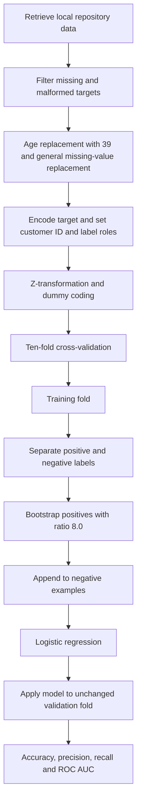
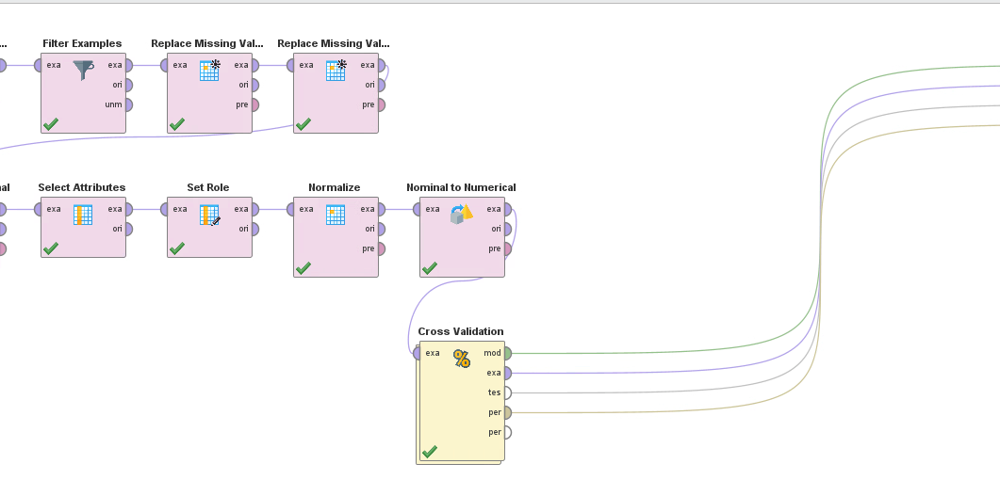
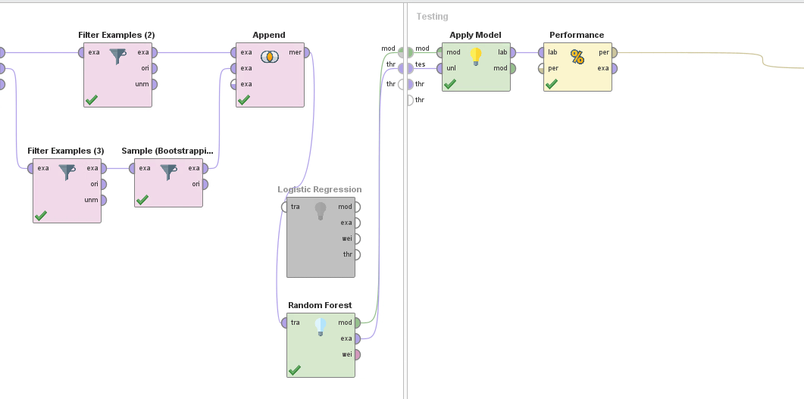
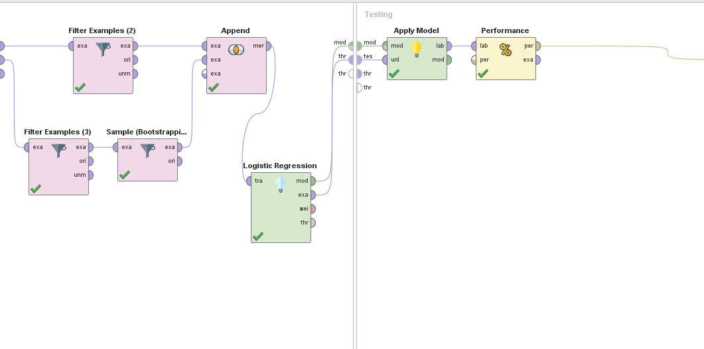

# Predictive modelling workflow

The canonical saved process is [`loan-default-original.rmp`](../rapidminer/loan-default-original.rmp), supplied under the student-named filename. It is retained without changing its operators or connections. Its process version is `10.3.001`. The actual report now supplies historical runs of both classifiers, process screenshots, results excerpts and confusion matrices. [The model comparison](model-results.md) records these outputs separately from the saved file state. No trained model or scored dataset was supplied.

## Original process

The original training sub-process selects positive examples, bootstraps that subset and appends it to negative examples. The bootstrap is inside cross-validation's training side. The saved `use_weights=true` setting matters: effective weighting and resulting training counts must be checked in the native tool before interpreting this as an exact class ratio.

## Model settings

| Setting | Logistic regression | Random forest |
| --- | --- | --- |
| Saved state | Enabled and connected to the model output | Disabled, retained for an alternative run |
| Operator | `h2o:logistic_regression` | `concurrency:parallel_random_forest` |
| Main settings | AUTO solver, intercept, no regularisation, max 100 iterations, remove collinear columns, standardise | 100 trees, maximum depth 10, gain ratio, confidence voting |
| Evaluation | Ten-fold CV, automatic sampling, top-level seed 2001 | No separate saved evaluation run |
| Historical report results | Accuracy 37.08%, default precision 12.64%, default recall 83.41% | Accuracy 83.59%, default precision 27.93%, default recall 34.59% |

The performance operator enables accuracy, precision, recall and AUC, and selects **recall** as its main criterion. Positive-class selection is automatic. An execution should explicitly verify that the positive label means default before reporting these metrics.

## Original execution screenshots

The report records model switching: Random Forest is active in the first training screenshot and Logistic Regression is active in the second. These figures establish historical configurations beyond the one enabled state in the saved RMP. Their exact run-to-file provenance and all parameters cannot be reconstructed from the images alone.

The actual report's matrices identify `true` as positive and total 1,061 actual positives, consistent with default=1. Full results are [checked separately](model-results.md).

## What the original design demonstrates

The workflow distinguishes the customer identifier from predictors, defines a binomial target, prepares mixed numeric/categorical attributes, considers imbalance during training and separates training/validation inside CV. The report additionally documents actual runs and their error tradeoff. The portfolio demonstrates both workflow design and interpretation of observed results; the validation limitations below qualify how strongly those results generalise.

With 8,937 non-defaults among 9,998 valid labels, predicting only non-default gives **89.39% accuracy and zero default recall**. A useful comparison therefore needs the confusion matrix, default recall, precision and ranking metrics alongside accuracy. This number is an arithmetic baseline, not a trained model result.

## Limitations identified during portfolio review

1. **Learned preprocessing precedes CV.** Normalisation, dummy coding and general missing-value replacement run before the fold split. Their fitted information can cross fold boundaries. The fixed age value 39 also matches the full labelled cohort's median; its original derivation is not recorded.
2. **There is no independent holdout operator.** The case calls for train/test separation and CV evidence. The saved workflow supplies internal CV folds; it does not demonstrate a separately reserved final test set. The 5,000 unlabelled rows are not an evaluable holdout without outcomes.
3. **Literal `?` values need an explicit rule.** A generic missing-value operator may not recognise a text sentinel as missing. Native repository import metadata and operator output must be checked.
4. **Sensitive attributes remain in the predictor selection.** Race, gender, origin and other demographic fields are dummy-coded in the original process. The files contain no subgroup performance or fairness evaluation.
5. **Historical results have incomplete run lineage.** The report establishes a comparison, while the saved RMP records one enabled model state. No prediction-level outputs or complete run configuration link every displayed metric to an exact executable artifact. The report's partial coefficients and one tree view do not establish a global predictor ranking.

## Archived alternative

[`archive/loan-default-alternative.rmp`](../rapidminer/archive/loan-default-alternative.rmp) comes from `A2.rmp`. It has stratified ten-fold CV with seed 123, bootstrap ratio 2.0 and additional disabled decision-tree/threshold operators. The operator named `age` actually selects `Loan_defaulted`, not `Age`. It is preserved as an alternate historical artifact and is not presented as a corrected or recommended workflow.

## Next evaluation design

This is a proposal for strengthening the historical evaluation, not a newly executed pipeline:

1. Validate labels and reserve a reproducible stratified final holdout from labelled records before fitting any transforms. Use a time-based holdout if dated outcomes become available.
2. Fit missing-value rules, category encoding and any scaling inside each CV training fold. Apply the fitted transforms to that fold's validation data.
3. Bootstrap or weight only training data. Keep validation and holdout prevalence unchanged, and record the resulting class counts and weights.
4. Compare logistic regression and random forest on identical folds. Save positive-label mapping, confusion matrices, default precision/recall, ROC AUC and PR AUC, with fold variability.
5. Select an operating threshold on validation data using stated false-negative/false-positive costs. Evaluate once on the untouched holdout, with calibration and subgroup diagnostics.

Missing deployment inputs include observation dates, outcome horizons, exposure/loss information and operational review costs. No approval threshold or financial benefit can be justified from these artifacts alone.

Background: [scikit-learn on preprocessing leakage](https://scikit-learn.org/stable/common_pitfalls.html#data-leakage). The source explains the evaluation principle; the findings above come from the actual RapidMiner operator order.
