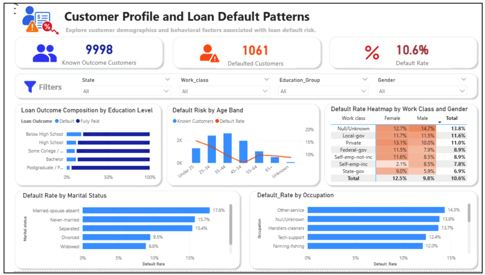
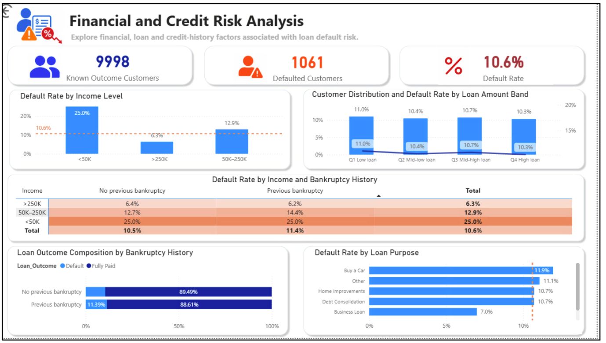
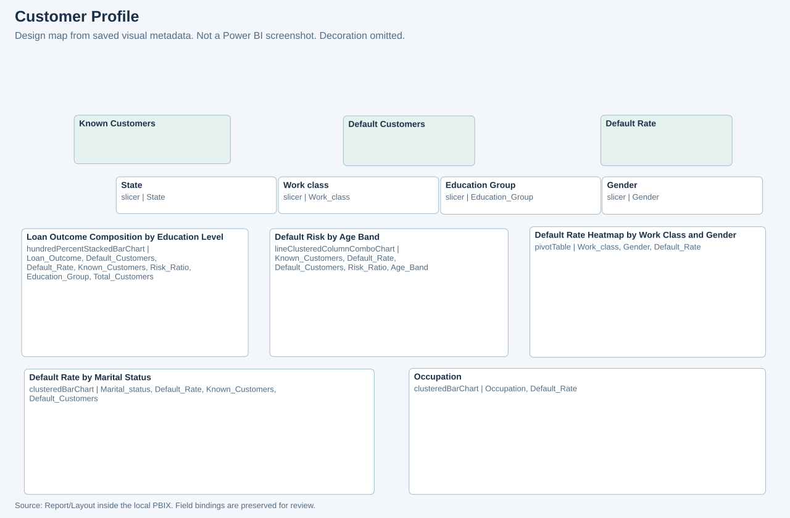
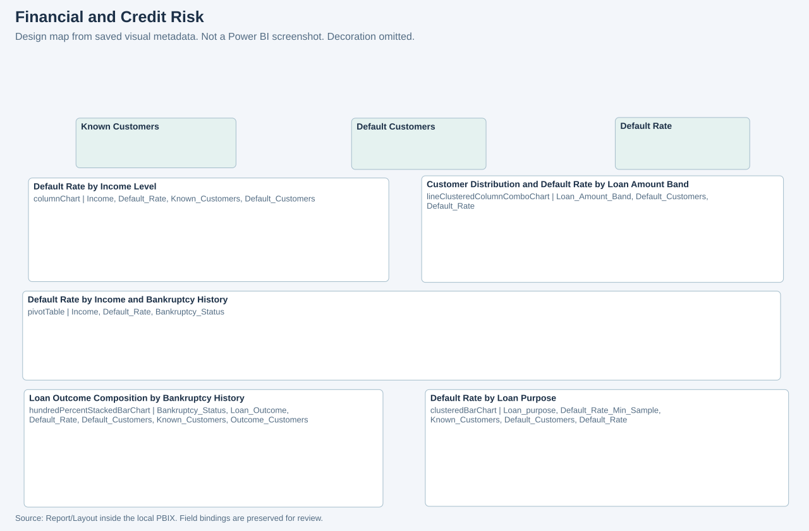

# Power BI implementation

The local PBIX contains one `Loan` table, two 1280 × 720 report pages, 12 measures and 13 DAX calculated columns. The public extraction includes logic and visual metadata, without the model's customer rows. The two supplied PBIX filenames have identical SHA-256 hashes.

## Report pages

| Page | Analytical visuals | Other functional elements |
| --- | --- | --- |
| Customer Profile | Age combo chart, education composition, marital-status bars, occupation bars, work-class/gender matrix | Three KPI cards, four slicers and one action button |
| Financial and Credit Risk | Loan-amount combo chart, income columns, income/bankruptcy matrix, loan-purpose bars, bankruptcy composition | Three KPI cards and one action button |

## Original dashboard screenshots

These are original embedded screenshots extracted from pages 3 and 4 of the actual assignment report. They contain aggregate analysis, not borrower-level records. Their source and checksums are in the [figure manifest](../evidence/figures/manifest.json).





The screenshots show 9,998 known outcomes, 1,061 defaults and a rounded 10.6% rate. Those values reconcile to the local CSV and stored PBIX. They also show the income-order issue and the loan-amount visual's two rate series identified in the offline review. These are historical views; the portfolio update does not execute slicers or refresh the native report.

## Metadata design maps

The maps below preserve saved positions and bindings for analytical visuals, cards and slicers. They omit decoration and do not execute Power BI rendering or reproduce displayed values.





Source: [`report-metadata.json`](../powerbi/report-metadata.json). Page counts exclude decorative text, shapes and images. These diagrams supplement the original report screenshots above.

## Metric design

The original [`measures.dax`](../powerbi/measures.dax) defines distinct customer counts, then restricts the default-rate denominator to known outcomes:

```dax
Default_Rate = DIVIDE([Default_Customers], [Known_Customers])
```

`Loan_Outcome` uses trimmed text and maps only `"1"` to `Default` and `"0"` to `Fully Paid`. All other values become `Unknown`. This preserves uncertainty instead of treating absent labels as successful repayments.

`Risk_Ratio` compares the current rate with the `ALLSELECTED('Loan')` context. `Outcome_Customers` uses `KEEPFILTERS` to retain an outcome segment while restricting it to known outcomes. `Default_Rate_Min_Sample` returns blank below 100 known customers; the loan-purpose chart binds to this measure.

`Customer_Share` and `Overall_Default_Rate_Fixed1` provide additional comparison logic. The original model also contains a similarly named `Overall_Default_Rate_Fixed` **calculated column**. Extracting a formula does not prove its suitability in every report context. The [full expressions](../powerbi/calculated-columns.json) allow that distinction to be reviewed.

## Feature preparation

Calculated columns create age bands and their order, education groups and their order, loan-amount bands, bank-balance bands, credit-history bands and a bankruptcy status. The numeric financial thresholds are hard-coded in the original model. Their quartile-style labels do not prove that thresholds recalculate on refresh or within a filtered cohort.

The original M query promotes headers, sets types and creates `Income_Sort`. The public [`Loan.original.pq`](../powerbi/Loan.original.pq) replaces only the original local file path with a parameter. [`Loan.portable.pq`](../powerbi/Loan.portable.pq) is a separately labelled proposal that handles the supplied CSV's CP1252 encoding and normalises the income dash for sorting. It has not been executed in Power BI.

## Review findings

| Observation | Evidence | Proposed change |
| --- | --- | --- |
| Income sort falls through for the middle group | M compares `50K-250K`, whereas the CSV uses `50K–250K`; the PBIX stores `Income_Sort=99` for 10,457 rows | Normalise the dash and surrounding whitespace before assigning sort keys; check native sorting after refresh |
| Loan-amount chart title promises distribution and rate, but both Y and Y2 bind to `Default_Rate` | Original financial-page combo-chart projections | Bind customer count or share to the column series and rate to the line; label both axes |
| Education composition uses `Total_Customers` | The stacked-bar Y binding is distinct from the financial page's `Outcome_Customers` | Check whether unknown outcomes belong in the composition and align denominator labels |
| Source path names a different CSV variant | The original M path ends in a `RowData-2.csv.csv` variant | Reconcile aggregates and transformation history before claiming complete record-level equivalence |

The stored model has 14,999 unique IDs, 8,937 fully paid outcomes, 1,061 defaults and 5,001 unknown outcomes. These reconcile to the separately supplied CSV's outcome counts and the report screenshots. Record-level equivalence, a fresh refresh, interactive testing and DAX-engine execution remain outside this offline review.

## Re-extract the logic

The optional [`extract_powerbi.py`](../scripts/extract_powerbi.py) uses [PBIXRay](https://github.com/Hugoberry/pbixray) 0.15.5 for model metadata and Python ZIP/JSON readers for the report layout. It writes no table records. Run it only against your authorised local PBIX; see [setup](setup.md).
